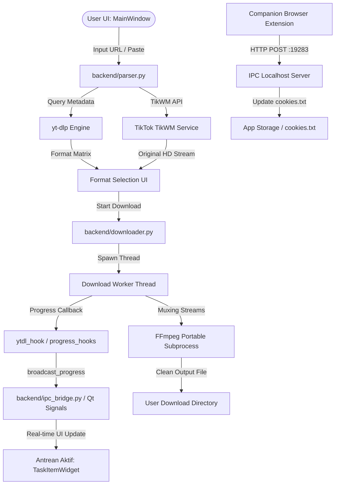

# System Architecture & Data Flow // Studio Download

Studio Download dibangun sebagai desktop media harvester dan transcoding suite untuk kreator konten dan editor video NLE (Premiere Pro, DaVinci Resolve, Final Cut Pro).

---

## 1. Lapisan Arsitektur (Layering)

### A. Presentation Layer (Desktop UI)
- **Framework**: `PySide6` (Qt 6.x for Python).
- **Styling**: Vanilla QSS terpusat di `ui/styles.py` (`MAIN_QSS`), mengimplementasikan JetBrains Mono Dark Zinc theme (`#09090b` background, `#14151b` card surface, `#27272a` borders, `#38bdf8` cyan accents, `#34d399` emerald success, `#fbbf24` amber warning, `#f43f5e` rose danger).
- **Komponen Kunci**:
  - `MainWindow`: Window utama, input URL hero bar, preview metadata & thumbnail, format selection matrix, dan active queue ledger.
  - `SettingsDialog`: Multi-tab modal dialog (Pref, Dir, Auth, Ext, Info) dengan navigasi sidebar vertikal dan re-translasi real-time.
  - `HistoryDialog`: Modal riwayat unduhan dengan fitur filter `grep` real-time.

### B. Business Logic & Processing Layer
- **`backend/parser.py`**:
  - Pengekstraksian format YouTube, penyaringan manifest internal HLS (`m3u8`), verifikasi ukuran riil byte dari CDN, dan penyusunan preset audio.
  - Penanganan khusus TikTok via TikWM API (HD no watermark, music mp3).
- **`backend/downloader.py`**:
  - Pengelola antrean tugas (*DownloadManager*), pemantauan kapasitas download serentak (*concurrency limit*), dan eksekusi thread terisolasi per tugas.
  - Pelaporan telemetri real-time: persentase, kecepatan (MB/s), sisa waktu (ETA), dan format ukuran dinamis (`MB` / `GB`).
- **`backend/i18n.py`**:
  - Mesin lokalisasi dua bahasa (`id` dan `en`) dengan fungsi `t(key)` dan sinyal pergantian bahasa langsung ke seluruh widget aktif.
- **`backend/config.py`**:
  - Manajemen persistence konfigurasi `settings.json`, registrasi user lokal `users.json`, dan resolver lokasi `cookies.txt`.

### C. External Tools & Ingestion Integrations
- **`yt-dlp`**: Ekstraksi stream video dan audio dengan bypassing bot check menggunakan `nodejs`, runtime JS, dan cookie injection.
- **`ffmpeg`**: Penggabungan track video DASH dan audio AAC/Opus tanpa re-encoding (copy stream), atau transcoding ke format ProRes / NLE compatible.
- **Companion Browser Extension**: Ekstensi Chromium Manifest V3 yang menyinkronkan cookies akun YouTube 1-klik melalui HTTP POST ke port local 19283.
